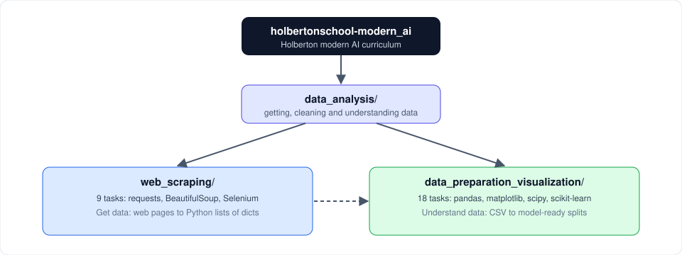

# Holberton School: Modern AI

Solutions to the projects of the Holberton *Modern AI* curriculum, organized by topic. Each task is a small, documented Python module with a `*-main.py` script that demonstrates it.



## Contents

| Folder | Focus | Tasks | Main tools |
|---|---|---|---|
| [data_analysis/](data_analysis/README.md) | Getting, cleaning and understanding data | 27 | requests, BeautifulSoup, Selenium, pandas, matplotlib, scipy, scikit-learn |

Inside `data_analysis/` there are two projects:

- [web_scraping/](data_analysis/web_scraping/README.md): collect data from websites, from static HTML to JavaScript-rendered pages.
- [data_preparation_visualization/](data_analysis/data_preparation_visualization/README.md): explore, test and prepare the Telco customer-churn dataset for modeling.

## Repository conventions

- Task files are named `<number>-<function_name>.py` and expose a function with the same name as the file (without the number).
- Every module has a module docstring and a function docstring with `Args` and `Returns`.
- Files named `<number>-main.py` are small runnable examples for the task with that number. They are not part of the solution.
- Files start with `#!/usr/bin/env python3`, and code follows pycodestyle.
- Tasks load each other with `__import__('<number>-<name>')` because file names start with a digit and cannot be imported normally.

## Setup

```bash
python3 -m venv .venv
source .venv/bin/activate            # Windows: .venv\Scripts\activate
pip install requests beautifulsoup4 selenium pandas numpy matplotlib seaborn scipy scikit-learn
```

Selenium tasks also need Google Chrome installed.

## Where to start

New to the repo? Read [data_analysis/README.md](data_analysis/README.md) for the big picture, then pick a project.
