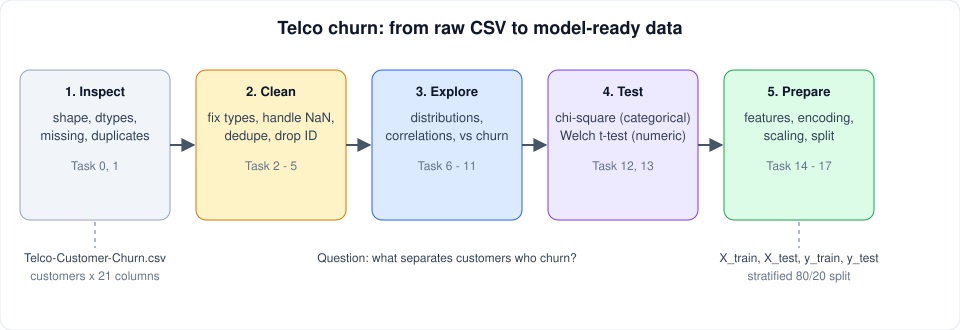

# Data Preparation and Visualization

Part of [data_analysis](../README.md) · [Repository README](../../README.md) · Previous project: [web_scraping](../web_scraping/README.md)

Eighteen tasks that take the **Telco Customer Churn** dataset from a raw CSV to model-ready train/test sets. The goal is to understand *which customers leave* (`Churn`) and to prepare data that a classifier can learn from.



## Dataset

- [Telco-Customer-Churn.csv](Telco-Customer-Churn.csv): one row per customer, with demographics (`gender`, `SeniorCitizen`, `Partner`, `Dependents`), account data (`tenure`, `Contract`, `PaymentMethod`, `MonthlyCharges`, `TotalCharges`), subscribed services, and the target `Churn` (Yes/No).
- [precleaned-Telco-Customer-Churn.csv](precleaned-Telco-Customer-Churn.csv): an already-cleaned version used as input by the later tasks.

## Key concepts

| Stage | Why it matters |
|---|---|
| **Inspect** | Check shape, types, missing values and duplicates before changing anything. |
| **Clean** | `TotalCharges` is text with blanks, so it must become numeric. Missing values can be dropped, filled with the median, or imputed as `MonthlyCharges * tenure`. IDs carry no signal and are dropped. |
| **Explore** | Class balance, distributions, correlations, and how each feature relates to churn. |
| **Test** | Chi-square tests for categorical features and Welch's t-test for numeric ones show which differences are statistically significant. |
| **Engineer** | Combine many columns into `NumServices` and bin `tenure` into `TenureGroup`. |
| **Encode and scale** | Models need numbers: label, ordinal and one-hot encoding, then standardization. |
| **Split** | A stratified 80/20 split keeps the churn ratio equal in train and test. |

## Tasks

### 1. Inspect and clean

| # | File | Function | What it does |
|---|---|---|---|
| 0 | [0-describe_data.py](0-describe_data.py) | script | Print shape, dtypes, first rows, missing values and duplicates. |
| 1 | [1-plot_missingness.py](1-plot_missingness.py) | `plot_missingness(df)` | Plot the position of every missing value. |
| 2 | [2-convert_columns.py](2-convert_columns.py) | `convert_columns(df)` | `TotalCharges` to numeric (blanks become NaN), `SeniorCitizen` 0/1 to No/Yes. |
| 3 | [3-clean_total_charges.py](3-clean_total_charges.py) | `clean_total_charges(df, method)` | Handle NaN with `drop`, `median` or `impute`. |
| 4 | [4-remove_duplicates.py](4-remove_duplicates.py) | `remove_duplicates(df)` | Drop duplicate rows. |
| 5 | [5-drop_customerID.py](5-drop_customerID.py) | `drop_customerID(df)` | Remove the identifier column. |

### 2. Explore and test

| # | File | Function | What it does |
|---|---|---|---|
| 6 | [6-plot_churn_distribution.py](6-plot_churn_distribution.py) | `plot_churn_distribution(df)` | Bar plot of churned vs retained customers. |
| 7 | [7-plot_categorical_distributions.py](7-plot_categorical_distributions.py) | `plot_categorical_distributions(df, columns_to_plot)` | Grid of value-count bar plots. |
| 8 | [8-plot_continuous_distributions.py](8-plot_continuous_distributions.py) | `plot_continuous_distributions(df, columns_to_plot)` | Histogram with KDE plus box plot per column. |
| 9 | [9-plot_correlation_heatmap.py](9-plot_correlation_heatmap.py) | `plot_correlation_heatmap(df)` | Annotated correlation matrix of numeric columns. |
| 10 | [10-plot_categorical_vs_churn.py](10-plot_categorical_vs_churn.py) | `plot_categorical_vs_churn(df, col)` | Churn rate per category. |
| 11 | [11-plot_numeric_vs_churn.py](11-plot_numeric_vs_churn.py) | `plot_numeric_vs_churn(df, col)` | Overlaid histograms for churn Yes and No. |
| 12 | [12-chi_square_tests.py](12-chi_square_tests.py) | `chi_square_tests(df)` | p-value of each categorical feature against `Churn`. |
| 13 | [13-ttest_numeric.py](13-ttest_numeric.py) | `ttest_numeric(df)` | Welch's t-test p-value of each numeric feature between churn groups. |

### 3. Prepare for modeling

| # | File | Function | What it does |
|---|---|---|---|
| 14 | [14-create_features.py](14-create_features.py) | `create_features(df)` | Build `NumServices` and `TenureGroup`, drop the source columns. |
| 15 | [15-encode_features.py](15-encode_features.py) | `encode_features(df)` | LabelEncoder for target, OrdinalEncoder for binary and tenure group, one-hot for `Contract` and `PaymentMethod`. Returns the fitted encoders too. |
| 16 | [16-scale_numeric.py](16-scale_numeric.py) | `scale_numeric(df)` | Standardize `MonthlyCharges` and `TotalCharges`. |
| 17 | [17-split_data.py](17-split_data.py) | `split_data(df, ...)` | Stratified train/test split (default 80/20, `random_state=42`). |

Most functions take a DataFrame and return a new one (or a plot), so they chain in order: `convert_columns` → `clean_total_charges` → `remove_duplicates` → `drop_customerID` → ... → `split_data`.

## Running

Install `pandas`, `numpy`, `matplotlib`, `seaborn`, `scipy` and `scikit-learn`, then from this folder:

```bash
python3 0-describe_data.py
python3 1-main.py        # example for task 1
```

## Notes

- Plot tasks call `plt.show()` and need a display.
- Fit encoders and scalers on training data only when you build a real model; here they are applied to the whole table for practice, so beware of data leakage.
