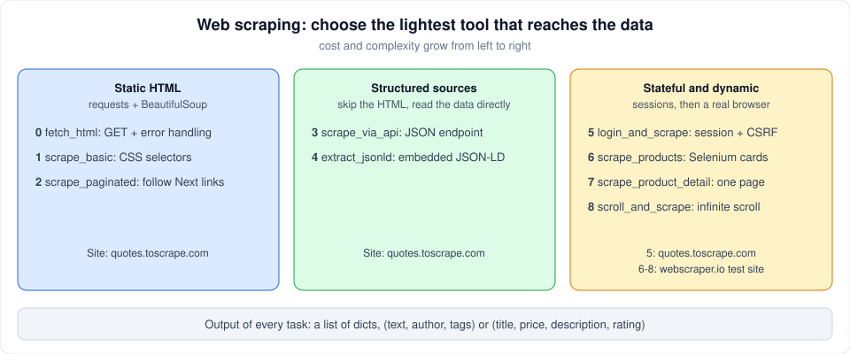

# Web Scraping

Part of [data_analysis](../README.md) · [Repository README](../../README.md) · Next project: [data_preparation_visualization](../data_preparation_visualization/README.md)

Nine tasks that collect the same kind of data (quotes, then products) with progressively more powerful techniques. The key lesson: **use the lightest tool that reaches the data.**



## Key concepts

| Concept | Idea |
|---|---|
| **Static HTML** | The data is in the page source. `requests` downloads it and BeautifulSoup selects elements with CSS selectors. |
| **Pagination** | Results span several pages. Follow the "Next" link until it disappears, with a pause between requests. |
| **Hidden APIs** | The page often loads data from a JSON endpoint. Calling it directly is faster and more stable than parsing HTML. |
| **JSON-LD** | Pages may embed machine-readable data in `<script type="application/ld+json">` blocks. |
| **Sessions and CSRF** | Logged-in content needs a `requests.Session` (cookies) and the hidden `csrf_token` from the login form. |
| **Headless browser** | When JavaScript builds the page, Selenium drives a real Chrome so the DOM is complete before scraping. |
| **Infinite scroll** | Scroll, wait for the page height to grow, repeat until it stops, then collect unique items. |

## Tasks

| # | File | Function | What it does |
|---|---|---|---|
| 0 | [0-fetch_html.py](0-fetch_html.py) | `fetch_html(url, headers=None, timeout=10)` | Reusable helper: GET a URL, raise on HTTP errors, return the HTML text. |
| 1 | [1-scrape_basic.py](1-scrape_basic.py) | `scrape_basic(url)` | Extract text, author and tags of every quote on one page. |
| 2 | [2-scrape_paginated.py](2-scrape_paginated.py) | `scrape_paginated(base_url)` | Follow "Next" links to collect quotes from all pages. |
| 3 | [3-scrape_via_api.py](3-scrape_via_api.py) | `scrape_via_api(base_url)` | Page through `/api/quotes?page=N` while `has_next` is true. |
| 4 | [4-extract_jsonld.py](4-extract_jsonld.py) | `extract_jsonld(url)` | Parse embedded JSON-LD (single objects, lists, `@graph`) and keep `Quote` items. |
| 5 | [5-login_and_scrape.py](5-login_and_scrape.py) | `login_and_scrape(login_url, user, pwd)` | Log in with a CSRF-protected form, then scrape the authenticated page. |
| 6 | [6-products_list.py](6-products_list.py) | `scrape_products(url)` | With Selenium, collect title, price, description and rating of each product card. |
| 7 | [7-product_detail.py](7-product_detail.py) | `scrape_product_detail(url, delay=2.0)` | With Selenium, extract the fields of one product detail page. |
| 8 | [8-scroll_and_scrape.py](8-scroll_and_scrape.py) | `scroll_and_scrape(url, scroll_pause=2.0)` | Scroll an infinite-scroll page to the end and return every unique product. |

Tasks build on each other: 1 uses 0, and 2 uses 0 and 1. The task 6 module also exposes the alias `scrape_products_list`.

## Targets

- [quotes.toscrape.com](https://quotes.toscrape.com/): tasks 0-5
- [webscraper.io test sites](https://webscraper.io/test-sites/e-commerce/static): tasks 6-8 (made for scraping practice)

## Running

Install `requests`, `beautifulsoup4` and `selenium` (Selenium needs Chrome). Then run a task's example from this folder:

```bash
./1-main.py        # or: python3 1-main.py
```

Each `N-main.py` demonstrates the task with the same number.

## Good practice shown here

- Always set a timeout and call `raise_for_status()`.
- Pause between page requests to be polite to the server.
- Guard against missing elements instead of crashing on `None`.
- Always quit the Selenium driver in a `finally` block.
- Scrape only sites that allow it; these targets are built for practice.
